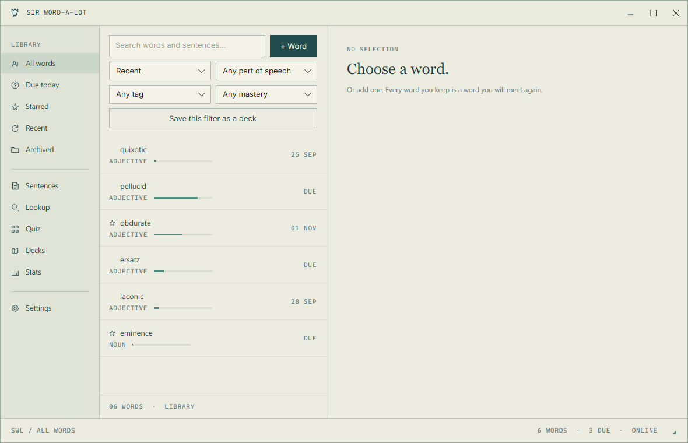
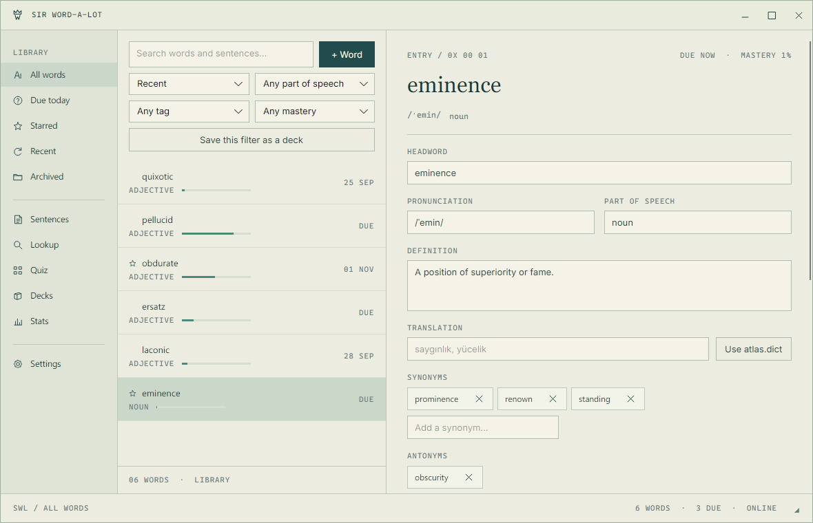

<div align="center">



**A vocabulary and thesaurus trainer, in the visual idiom of HammerOS.**

[](#install)
[](#build-from-source)
[](#build-from-source)
[](#verification)
[](LICENSE.txt)

</div>

---

Meet a word. Keep the sentence you met it in. Meet it again on a schedule until
it stays. Clicking a synonym you do not own yet offers to add it, so one word
fans out into a network rather than sitting alone on a list.

Cream institutional chrome, petrol surfaces, phosphor typography, and an
unreasonably formal tone about the business of remembering words.

## Install

**Windows.** Download `SirWordALot-Setup-<version>.exe` from
[Releases](../../releases) and run it. The build is self-contained; there is no
runtime to install first.

**macOS and Linux.** Build from source, below. Both platforms are supported in
the code and cross-compile cleanly to native binaries, and the window draws
traffic lights on the left in this palette rather than glyph buttons on the
right. They are not yet part of a release, and have not been run on a real
machine of either kind, so treat them as buildable rather than tested.

Your library starts with sixty words, already due. Press `Q` for a quiz, or
`Ctrl+Space` to go anywhere.

## What is inside

| View | What it does |
| --- | --- |
| **Library** | Search, filter and sort every word. Edit headword, pronunciation, part of speech, definition, translation, relations, sentences, tags and notes. |
| **Sentences** | The sentence bank. Paste a sentence and it links itself to any word it contains, inflections included, so `obfuscates` finds `obfuscate`. |
| **Lookup** | Synonyms, antonyms, related words and rhymes from Datamuse; senses, pronunciation, audio and real examples from dictionaryapi.dev. Tick exactly what you want and add it. Turkish meanings come from the bundled dictionary and need no connection at all. |
| **Quiz** | Flip, multiple choice, cloze and typed drills over SM-2 or Leitner, with the resulting interval printed on every grade button. |
| **Decks** | Manual decks, plus smart decks saved from a library filter and re-evaluated live. |
| **Stats** | Streak, retention, a 53-week review heatmap, mastery breakdown and a retention curve. |
| **Settings** | Palette, motion, scheduler, daily caps, capture hotkey, lookup switch, export, import and restore. |

<div align="center">



</div>

## Keys

| Shortcut | Action |
| --- | --- |
| `Ctrl+Space` | Command palette over views, words, decks, tags and actions |
| `Ctrl+Alt+W` | Capture the clipboard word from anywhere |
| `/` | Focus search |
| `N` | New word |
| `Q` | Start a quiz |
| `Space` | Flip the card |
| `Enter` | Confirm the suggested grade |
| `1` – `4` | Grade Again, Hard, Good, Easy |
| `Esc` | Back, or end the session |

## Scheduling

SM-2 by default. Ease starts at 2.5 and floors at 1.3.

| Grade | Interval | Ease |
| --- | --- | --- |
| Again | back to now, requeued this session, lapse recorded | −0.20 |
| Hard | current interval × 1.2 | −0.15 |
| Good | 1 day, then 6, then interval × ease | unchanged |
| Easy | 4 days, then interval × ease × 1.3 | +0.15 |

Intervals above two days get ±5% fuzz so cards do not clump, and are capped at a
year. Leitner is available in Settings: five boxes at 1, 2, 4, 8 and 16 days,
where Again returns to box 1, Hard holds, and Good or Easy promote. Switching
scheduler converts your existing progress and keeps your due dates rather than
resetting you.

**Auto-graded modes suggest, they do not record.** Answering a choice, cloze or
typed card reveals the answer with the computed grade preselected; the review is
written when you confirm it. Recording before you have seen whether you were
right would make the override meaningless.

**Free practice** writes no scheduling at all, so drilling for fun never
pollutes your retention statistics.

## The offline dictionary

31,835 English headwords with Turkish meanings ship inside the binary, exported
from [atlas.dict](https://github.com/fezcode/atlas.dict). Every word you
add has its translation filled from them automatically, and words already in
your library with a blank translation are filled on the next start. They power the Turkish section in Lookup, and back the "did you
mean" suggestions when a word is not found. None of it touches the network.

A caveat worth stating plainly: the source is a *translation* dictionary. Across
its 34,406 headwords and 74,656 senses it carries seven English glosses, six
examples and seven synonyms. So it supplies meanings in Turkish, not English
definitions, phonetics or parts of speech. Those come from the online services,
or from you.

## Your data

Everything lives in `%APPDATA%\fezcode\SirWordALot`: `library.db` (SQLite, WAL)
and `backups\`. A timestamped JSON snapshot is written at launch and at most
hourly, and the newest twenty are kept.

JSON export is lossless. It round-trips relations, sentences with their cloze
spans, SRS state and the full review history, so export then import reproduces
the library exactly. CSV and Anki TSV are lossy exchange formats, offered for
getting words out to other tools.

The only network calls are to `api.datamuse.com` and `api.dictionaryapi.dev`,
and only when you use Lookup. Turning lookup off in Settings stops them
entirely. Nothing else ever leaves the machine.

## Build from source

Requires the .NET 10 SDK.

```powershell
git clone https://github.com/fezcode/SirWordALot.git
cd SirWordALot
dotnet run --project SirWordALot.csproj
```

For a self-contained binary on any supported platform:

```powershell
./build.ps1 -Rid win-x64      # or osx-x64, osx-arm64, linux-x64, linux-arm64
```

Cross-compiling works from any host. The script verifies a cross-built binary
is a genuine Mach-O or ELF image for its target, but cannot run it, so it says
so instead of reporting a pass it did not observe.

`--help` and `--version` print to the console and exit. `--selftest` opens
SQLite and loads the embedded dictionary without showing a window, which is how
the published single-file bundle is verified.

### Release

```powershell
./version.ps1 -Bump patch     # keep every version site in lockstep
./build.ps1                   # build, verify, publish, prove it runs
./installer.ps1 -SkipBuild    # Forge Setup into dist/installer
```

The installer needs the sibling [Forge](https://github.com/fezcode/Forge)
project built with `gobake build`. The full flow is written down in
[AGENTS.md](AGENTS.md).

## Verification

Four layers, none of which drive the live desktop.

| Layer | Command | Covers |
| --- | --- | --- |
| Unit tests | `dotnet test tests/SirWordALot.Tests.csproj` | schema and migrations, CRUD, SM-2 and Leitner transition tables, mastery, inflection-aware cloze, edit-distance grading, queue construction and daily caps, full-text search, JSON/CSV/TSV round-trips, merge conflicts, backups, lookup parsing, the offline dictionary |
| Controls | `dotnet run --project tools/Checks` | palette, typography, window geometry, resize zones, and every view's behaviour through real Avalonia controls, headless |
| Pixels | `dotnet run --project tools/Preview -- dist/preview` then `tools/Measure` | renders every view, the icon set and this banner, then measures the palette and chrome geometry back out of the PNGs |
| Shipping | `--selftest` on the published binary | the native SQLite dependency and the embedded dictionary inside a single-file bundle, which `dotnet run` resolves differently |

The pixel layer earns its place: it caught a bug where every rendered view came
out fully transparent, because `Motion` animates opacity through a
`DispatcherTimer` that nothing pumps in a headless render. The measurements had
been passing on window chrome alone.

## Structure

```
Core/     SQLite, scheduling, cloze, search, sessions, stats, portability,
          lookup, the offline dictionary. No Avalonia reference; a test asserts it.
Shell/    Frameless window, palette, control factories, motion, command palette,
          global capture hotkey.
Views/    One file per screen.
tools/    Headless checks, preview renderer, pixel measurements.
```

## Acknowledgements

The visual language is lifted from [HammerOS](https://github.com/fezcode/hammeros),
an unaffiliated fan project inspired by *Severance*. Thesaurus data from
[Datamuse](https://www.datamuse.com/api/); dictionary senses from
[dictionaryapi.dev](https://dictionaryapi.dev); Turkish meanings from
[atlas.dict](https://github.com/fezcode/atlas.dict).

An independent project, unaffiliated with Apple or *Severance*.

## License

[MIT](LICENSE.txt)

## Application icon

The approved transparent artwork is `Assets/icon-master.png`. Run `python tools/make-icon.py` with Python and Pillow to regenerate the PNG sizes, Windows ICO and raster-backed SVG wrapper. Generated assets are committed; normal builds do not require Python.
